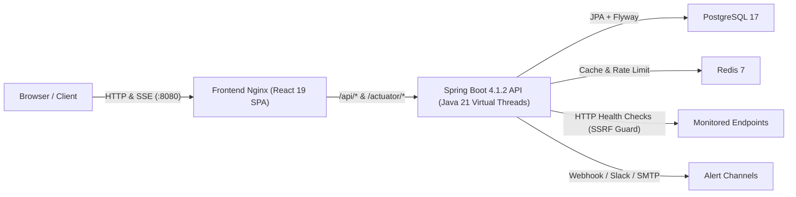

# OpsPulse

> Production-ready Uptime Monitoring, Alerting & Incident Management SaaS platform.

OpsPulse is a resilient, multi-tenant uptime monitoring and incident response platform built with modern Java and React engineering standards. It executes high-concurrency endpoint health checks using Java Virtual Threads, enforces SSRF protections, tracks full incident lifecycles, streams live workspace events over SSE, routes alerts across multiple channels, and serves cached, rate-limited public status pages.

---

## Key Features

- **Virtual-Thread Monitoring:** High-throughput, non-blocking HTTP endpoint health checks powered by Java 21 Virtual Threads and a configurable polling scheduler.
- **SSRF Protection:** Strict target URL validation that blocks private, loopback, link-local, and metadata IP ranges by default.
- **Incident Lifecycle Management:** Automated incident opening and resolution tied to monitor state transitions, with manual acknowledgement and timeline tracking.
- **SSE Live Updates:** Real-time Server-Sent Events (SSE) streaming monitor checks, status changes, and incident updates directly to workspace dashboards.
- **Multi-Channel Alerting:** Configurable alert routing via generic Webhooks, Slack incoming webhooks, and SMTP Email notifications.
- **Maintenance Windows:** Scheduled maintenance windows per workspace to suppress false-positive alerts during planned downtime.
- **Public Status Pages:** Shareable, unauthenticated status pages backed by Redis response caching and per-IP Redis rate limiting.

---

## Architecture



---

## Tech Stack

- **Backend:** Java 21, Spring Boot 4.1.2, Spring Security (Stateless JWT + Refresh Tokens), Spring Data JPA, Flyway DB Migrations, Spring Actuator.
- **Frontend:** React 19, TypeScript, Vite, Tailwind CSS v4, Lucide Icons, Nginx (unprivileged container).
- **Data & Cache:** PostgreSQL 17, Redis 7.
- **Testing & Quality:** JUnit 5, Mockito, Testcontainers (PostgreSQL & Redis), Oxlint.
- **Infrastructure:** Docker, Docker Compose (`compose.yaml` & `compose.prod.yaml`).

---

## Project Structure

```text
opspulse/
├── backend/            # Spring Boot REST API, scheduler, alerting, and Flyway migrations
│   ├── Dockerfile      # Multi-stage JDK 21 build + minimal non-root JRE 21 runtime
│   └── src/
├── frontend/           # React 19 + TypeScript SPA and Nginx reverse proxy config
│   ├── Dockerfile      # Multi-stage Node 22 build + unprivileged Nginx 1.27 runtime
│   ├── nginx.conf      # Reverse proxy for /api/, SSE streaming, and /actuator/
│   └── src/
├── compose.yaml        # Local development infrastructure (PostgreSQL 17 & Redis 7)
├── compose.prod.yaml   # Full production Docker Compose stack with healthchecks
├── .env.example        # Documented environment variable template
└── README.md
```

---

## Quickstart

### Prerequisites

- **Java 21** JDK
- **Node.js 22+** and `npm`
- **Docker** and **Docker Compose**

### Option 1: Local Development

1. **Configure environment variables:**
   ```bash
   cp .env.example .env
   ```

2. **Start PostgreSQL and Redis:**
   ```bash
   docker compose up -d
   docker compose ps
   ```

3. **Run the backend API:**
   ```bash
   cd backend
   ./mvnw spring-boot:run
   ```
   *(On Windows PowerShell, use `.\mvnw.cmd spring-boot:run`.)*

   The API listens on `http://localhost:8080` and Flyway runs database migrations automatically on startup.

4. **Run the frontend dev server:**
   ```bash
   cd frontend
   npm install
   npm run dev
   ```
   The Vite dev server starts on `http://localhost:5173`.

---

### Option 2: Production Docker Compose

1. **Create and configure `.env`:**
   ```bash
   cp .env.example .env
   ```
   Ensure `POSTGRES_PASSWORD` and `JWT_SECRET` (at least 32 random bytes) are set to strong production values, and update `CORS_ALLOWED_ORIGINS` (e.g., `http://localhost:8080` or your domain).

2. **Build and start the full stack:**
   ```bash
   docker compose -f compose.prod.yaml up -d --build
   ```

3. **Verify service health:**
   ```bash
   docker compose -f compose.prod.yaml ps
   ```
   Once `postgres`, `redis`, and `backend` report `healthy`, the application is accessible at `http://localhost:${FRONTEND_PORT:-8080}` (default `http://localhost:8080`).

4. **Stop the stack:**
   ```bash
   docker compose -f compose.prod.yaml down
   ```

---

## Testing & Verification

### Backend Tests (Testcontainers)

Requires a running Docker daemon for PostgreSQL and Redis Testcontainers:

```bash
cd backend
./mvnw test
```

### Frontend Lint & Production Build

```bash
cd frontend
npm run lint && npm run build
```

---

## License

Distributed under the MIT License.
